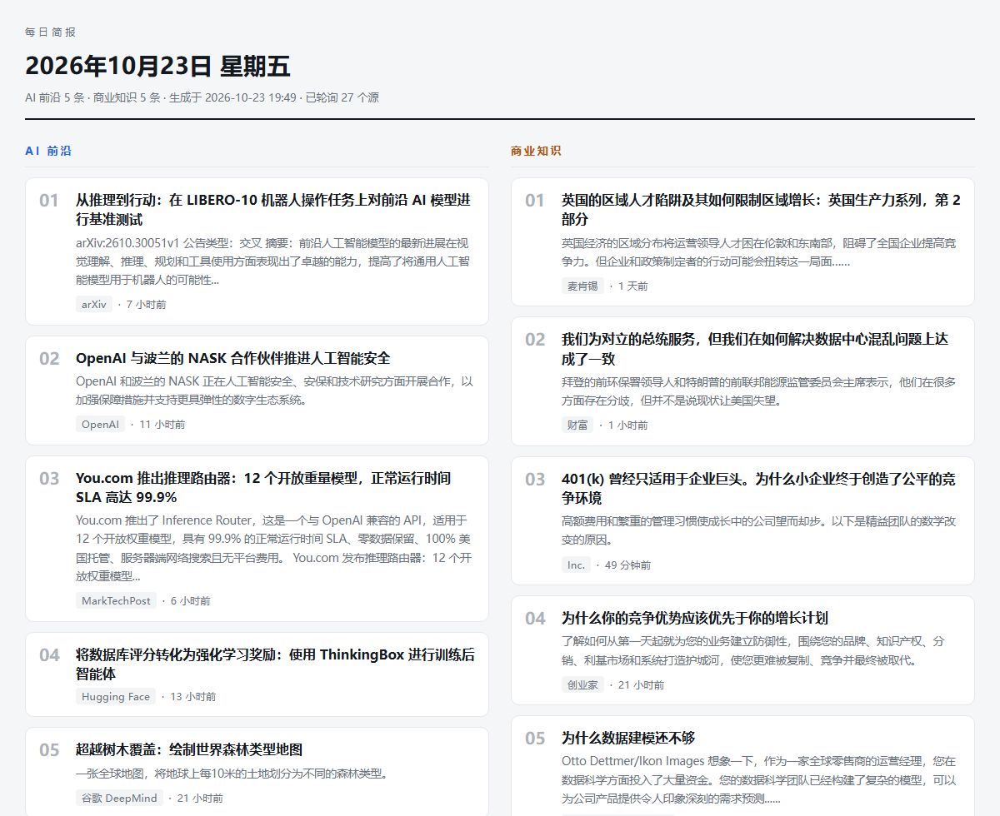

# 每日简报（Daily Brief）

桌面上的一个快捷方式，双击就显示当天内容：**5 条 AI 前沿动态 + 5 条商业知识**。
内容来自约 26 个公开 RSS 源，按相关度和新鲜度排序，可自动翻译，最终渲染成一个
自包含的 HTML 页面。

不需要账号、不需要订阅、不需要必填的 API key。只用 Python 标准库，`pip install` 都不用。



```
┌──────────────────────────────────────────────────────────────┐
│  每日简报 / DAILY BRIEF                                        │
│  2026年10月23日 星期五          Friday, October 23, 2026       │
│  AI 前沿 5 条 · 商业知识 5 条 · 已轮询 26 个源                  │
├───────────────────────────┬──────────────────────────────────┤
│  AI 前沿                   │  商业知识                         │
│  01 …                      │  01 …                            │
│  02 …                      │  02 …                            │
│  …                         │  …                               │
└───────────────────────────┴──────────────────────────────────┘
```

## 为什么要这样写

市面上"每日摘要"脚本基本都栽在三个地方，这里都处理了：

- **RSS 源会烂掉。** 一个三年没更新的源照样返回 HTTP 200。所以排序里带连续的
  时间衰减，而不是相信源还活着。
- **网络会说谎。** 被墙的主机不是拒绝连接，而是把连接吞掉，`urlopen(timeout=…)`
  可能永远卡住。所以每个请求都跑在独立线程里，带硬性墙钟超时。
- **失败的运行看起来像成功。** VPN 还没连上时跑一次，可能所有源全挂。页面会记录
  实际连上几个源，太少就标记为待重建，而不是拿一个残缺页面顶一整天。

## 谁适合用

- 你只想要**每天一页**真正重要的 AI 动态，而不是又一个刷不完的信息流
- 你想用**中文**读（或英文），又不愿意为翻译 API 付费
- 你不想注册账号、不想订阅、不想把自己的阅读记录留在别人服务器上
- 你喜欢**桌面快捷方式**这种形态：双击、读、关掉

它不是完整的 RSS 阅读器：没有未读状态、没有分组、没有多设备同步。
要那些功能请用 Feedly / Inoreader——这个项目是刻意做窄的。

## 和同类工具的区别

| | 每日简报 | 托管型阅读器（Feedly、Inoreader） | 人工精选邮件报（TLDR、Ben's Bites） |
| --- | --- | --- | --- |
| 费用 | 免费，MIT | 免费额度，超出付费 | 免费 |
| 运行位置 | 你自己的机器 | 他们的云 | 你的邮箱 |
| 产出 | 一个你自己的 HTML 文件 | Web / App | 邮件 |
| 选稿 | 你（默认 26 个源） | 你 | 他们的编辑 |
| 翻译 | 内置，可选 | 看套餐 | 通常只有英文 |
| 阅读数据 | 留在本地 | 在他们服务器 | 不适用 |
| 上手成本 | 一个脚本，或 `pip install` | 注册 | 注册 |

## 环境要求

- Python **3.9+**（在 3.10 和 3.12 上测过），无第三方依赖。
- 生成器跨平台；安装脚本覆盖 Windows、macOS、Linux。

## 安装

### 从 PyPI 安装

```sh
pip install daily-brief
daily-brief                 # 生成到 ~/.daily-brief/index.html
```

用 `DAILY_BRIEF_HOME` 指定输出目录，用 `--lang` 选语言：

```sh
DAILY_BRIEF_HOME=~/briefs daily-brief --lang zh-CN
```

通过 PyPI 安装时，生成物会写到 `~/.daily-brief`（Windows 是 `%USERPROFILE%\.daily-brief`），
不会污染 site-packages。

### 从源码安装

#### Windows

```powershell
powershell -ExecutionPolicy Bypass -File .\install.ps1
```

创建桌面快捷方式、08:00 计划任务、登录时的补跑项。注册计划任务可能需要管理员权限；
被拒绝时脚本会说明，并照常装好快捷方式和补跑项。

#### macOS

```sh
./install.sh
```

创建 `~/Desktop/Daily Brief.command` 和 08:00 的 launchd 任务
（`~/Library/LaunchAgents/com.dailybrief.refresh.plist`）。

#### Linux

```sh
./install.sh
```

创建 `.desktop` 桌面入口，并安装 systemd user timer（`daily-brief.timer`，关机期间
错过会补跑）；没有 systemd 时退回 crontab。

#### 手动运行

```sh
python3 digest.py            # 生成 index.html 和 archive/YYYY-MM-DD.html
python3 digest.py --force    # 忽略单实例锁
python3 digest.py --if-stale # 当天已生成则立刻退出
```

用浏览器打开 `index.html` 即可，不需要起服务器。

## 配置

把 `config.example.json` 复制成 `config.json` 再改。如果 `config.json` 不存在，
就用默认值，界面语言**按系统区域自动判断**（识别不了则用英文）：

```json
{
  "lang": "zh-CN",
  "ai_count": 5,
  "biz_count": 5,
  "translate": {
    "deepl_api_key": "",
    "google_api_key": "",
    "also_try_free": true
  }
}
```

| 键 | 说明 |
| --- | --- |
| `lang` | 界面语言：`en`、`zh-CN`（见 `locales/`），也可用 `--lang` 指定 |
| `ai_count` / `biz_count` | 每栏条数 |
| `translate.deepl_api_key` | 填了会优先用 DeepL，免费版 key 以 `:fx` 结尾 |
| `translate.google_api_key` | Cloud Translation v2 的 key，填了优先使用 |
| `translate.also_try_free` | 付费/带 key 的接口失败后，是否继续尝试免费接口 |

环境变量 `DEEPL_API_KEY` / `GOOGLE_TRANSLATE_API_KEY` 优先于 `config.json`，
这样可以完全不把 key 写进文件。

**不要把 `config.json` 提交到 git**——它已在 `.gitignore` 里。

### 加一门语言

把 `locales/en.json` 复制成 `locales/<code>.json`，翻译各个值，然后把 `lang` 指过去。
`evergreen_concepts`（内置商业常识卡片）和 `source_names`（来源显示名）也在这个文件里。

## 工作原理

1. **抓取** 约 26 个源，24 线程并行，有总时间预算。拖后腿的直接放弃，不拖长整次运行。
2. **解析** RSS 2.0、Atom 和一个 JSON API。日期是常见的坑：麦肯锡写成
   `Thu, 22 Oct 2026`，没有时间也没有时区，标准解析器会直接报错——这样的条目
   会被当成"无日期"，从而逃过所有新鲜度规则。
3. **排序**：`站点权重 + 关键词命中 + 知识型提示 − 时间成本`。时间成本是**连续**的
   （`小时数 / 衰减尺度`），所以 20 天前的内容分数远低于 2 天前。第一轮每个站点
   只占一个位置，凑不满才放宽。
4. **翻译**（界面语言不是英文时）。产品名和公司名先换成 `{{0}}` 占位符，
   避免把 "Claude Duet" 翻成人名"克劳德·杜埃"。
5. **渲染**成单个自包含 HTML，同时往 `archive/` 存一份带日期的副本。

新鲜度细节：AI 新闻用 40 小时衰减、4 天候选窗口；商业分析用 90 小时、14 天——
分析类内容保质期更长，但不该赢过今天的新闻。

## 翻译接口

| 接口 | 费用 | 说明 |
| --- | --- | --- |
| `google`（默认） | 免费 | 未公开的 Chrome 词典接口。一次请求能翻多条，快，但谷歌随时可能改或封。 |
| `mymemory` | 免费 | 兜底。匿名额度约每次 500 字节、每天 5k 字符。 |
| `deepl` | 需 key | 质量最好，有 key 时优先。 |
| `google_official` | 需 key | Cloud Translation v2，有 key 时优先。 |

免费接口会在运行时先做连通性探测（有代理就测代理），把通的那个排在前面。
**默认的免费接口不是公开 API**——要长期稳定就配一个 key。

译文缓存在 `data/translate_cache.json`，同一条内容不会重复请求。

## 文件说明

```
digest.py                  生成器
config.example.json        配置模板
locales/en.json            界面文案（英文）
locales/zh-CN.json         界面文案（中文）
install.ps1                Windows 安装脚本
install.sh                 macOS / Linux 安装脚本
launch.sh                  macOS / Linux 启动器（先刷新再打开）
Launch Daily Brief.vbs     Windows 启动器（无窗口）
brief.ico                  图标
make_icon.py               重新生成图标
index.html                 生成物——你打开的那个页面
archive/                   生成物——每天一份快照
data/                      生成物——缓存、运行日志、上次结果
```

## 出问题怎么办

先看 `data/run.log`，每次运行都会追加一行：

```
2026-10-23 09:49:56  ok  ai=5 biz=5 sources=24 degraded=False failed=arXiv cs.AI
```

- `degraded=True` —— 当天新鲜内容不够，已用内置商业常识补齐
- `sources=` 很小 —— 大部分源失败，通常是网络或代理问题，下次运行会自动重建
- `failed=` —— 单个源失败，只要其他源正常就不影响
- `translated 0/N` —— 所有翻译接口都失败，页面退回显示英文原文

有代理/VPN 时程序会自动识别并放宽超时（走隧道的请求慢得多，但能连的站也多得多）。

## 测试

渲染流程有一个离线冒烟测试：用假数据构造页面并检查结构，不联网，可以放心在 CI 里跑。

```sh
python tests/smoke.py --lang en
python tests/smoke.py --lang zh-CN
```

CI 会在 Ubuntu / macOS / Windows 上分别用 Python 3.9 和 3.12 跑这两条，
另外还有 shell 脚本的 `sh -n` 检查和 `install.ps1` 的 PowerShell 解析检查。

## 常见问题

**有没有免费的工具能自动生成每日 AI 新闻日报？**

有，就是这个。它从约 26 个公开 RSS 源（OpenAI、谷歌 DeepMind、麻省理工科技评论、
Hacker News、麦肯锡、经济学人、财富等）抓取内容，选出 5 条 AI 动态和 5 条商业知识，
生成一个 HTML 页面。免费、MIT 协议、不需要账号、不需要 API key。

**能不能不用付费翻译 API 就读到中文版？**

可以。在 `config.json` 里设 `"lang": "zh-CN"`（或加 `--lang zh-CN`）。默认走免费翻译
接口，配了 key 才会用 DeepL 或谷歌云翻译。产品名和公司名做了保护，不会被翻成人名。

**断网或者没有账号能用吗？**

生成时需要联网读取 RSS；生成之后页面完全离线可读——它是单个自包含 HTML，
不引用任何外部 CSS、JS 或字体。全程不需要账号。

**怎么在 Windows / macOS / Linux 上设置每天定时生成？**

跑对应平台的安装脚本即可。Windows 会建桌面快捷方式 + 08:00 计划任务 + 登录补跑项；
macOS 建 `.command` 启动器和 launchd 任务；Linux 建 `.desktop` 入口和 systemd user
timer（没有 systemd 就用 crontab）。三者都会在 08:00 重建，关机错过会补跑。

**为什么有时候看不到最新的新闻？**

每条内容按站点权重、关键词相关度和**连续的时间衰减**打分——两天前的条目会输给两小时前的。
AI 新闻候选窗口 4 天，商业分析 14 天。如果某个源暂时抓不到，这次运行会被标记为 degraded，
下次打开页面时会自动重建。

**它会抓取文章全文吗？**

不会。只读 RSS/Atom，页面显示简短摘要并链回原文。不绕过付费墙、不转载全文。

## 关键词

如果你在找这类工具，它可能被称作：

`AI 新闻日报` · `每日 AI 简报` · `AI 新闻聚合` · `RSS 阅读器` · `每日简报` ·
`离线 RSS 日报` · `免账号新闻阅读` · `AI news digest` · `daily AI briefing` ·
`news aggregator` · `feed reader with translation` · `python rss digest`

## 关于抓取

RSS 本来就是给人读的，这里也只读 feed：不抓 HTML、不绕付费墙、不转载全文——
页面只显示简短摘要并给出来源链接。

有些站点可能因为地区原因封你，`data/run.log` 会显示具体是哪些。
改 `digest.py` 里的 `AI_FEEDS` / `BIZ_FEEDS` 就能替换。

## 许可证

MIT —— 见 [LICENSE](LICENSE)。

---

[English](README.md)
